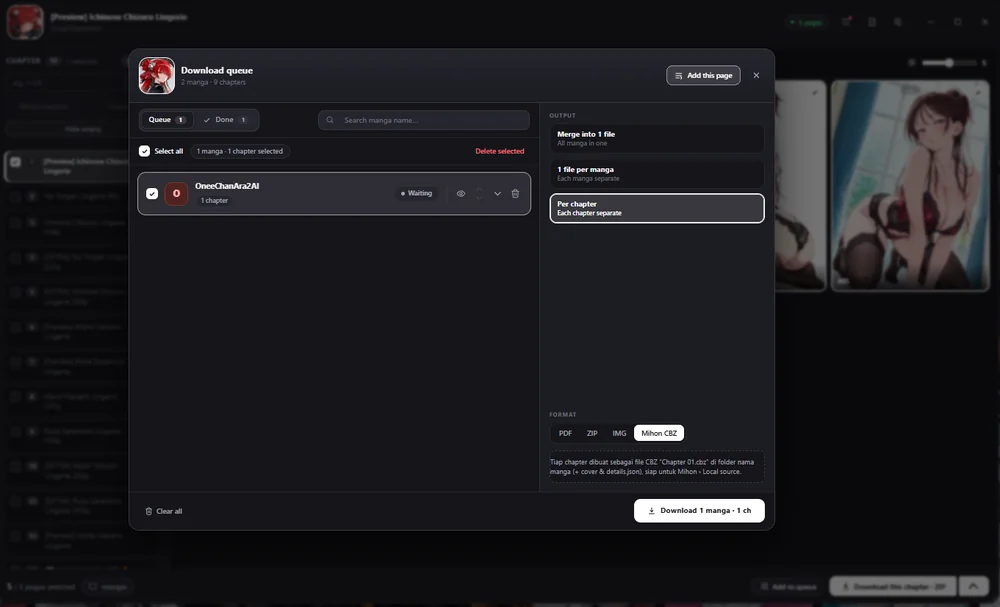
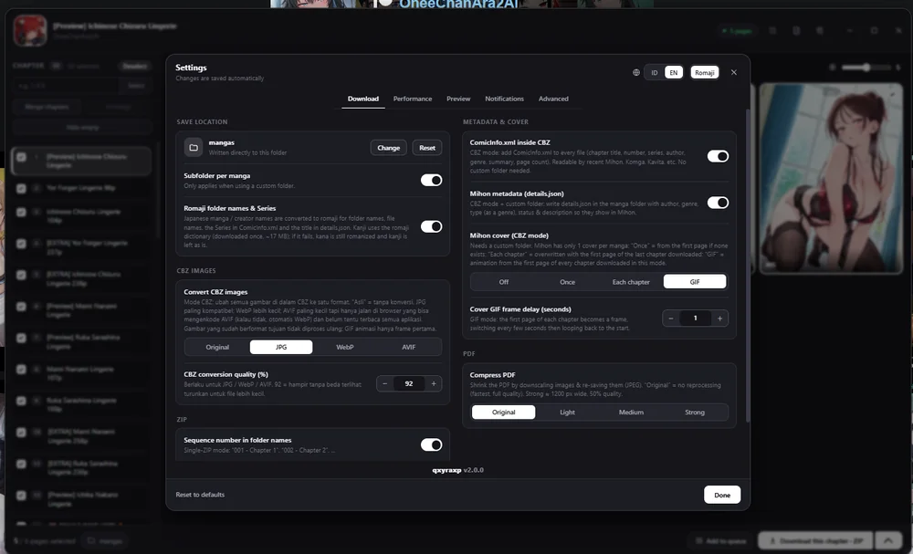

# Pawchive Downloader — CBZ, ZIP & PDF

[English](#english) · [Bahasa Indonesia](#bahasa-indonesia)

> ⚠️ **Disclosure / Pernyataan:** This script was made 100% using AI. / Script ini dibuat menggunakan AI 100%.

---

## English

A userscript for [pawchive.pw](https://pawchive.pw) that lets you preview, select, edit and download images in bulk. Creators are treated as "manga" and posts as "chapters", so the output works well with manga readers such as Mihon.

### Install

1. Install a userscript manager, for example [Tampermonkey](https://www.tampermonkey.net/) or [Violentmonkey](https://violentmonkey.github.io/).
2. Click the install link: **[pawchive-downloader.user.js](https://raw.githubusercontent.com/qxyraxp/pawchive-downloader/main/pawchive-downloader.user.js)**
3. Confirm the installation in your userscript manager.

### Features

- Preview and select the images you want to download
- Edit images before downloading: merge, split, crop and resize
- Download as **ZIP**, **PDF**, loose **images**, or **CBZ**
- CBZ output for **Mihon**: `ComicInfo.xml`, `details.json` and a cover image
- Mihon cover modes: Off, Once, Each chapter, or animated GIF
- Optional image conversion inside CBZ (JPG / WebP / AVIF, adjustable quality)
- PDF compression (Light, Medium, Strong)
- Multi-creator download queue with a "Done" tab
- Queue output: merge into 1 file, 1 file per manga, or per chapter
- Search and notifications
- Folder names and Series titles can be converted to **romaji** automatically
- Merge chapters, reorder pages, and move pages between chapters
- Settings are saved automatically
- UI available in Indonesian and English
- Scan all list pages: fetch chapters from every page of a creator, not just the open one
- Skip posts without attachments (text-only posts)

### Screenshots

**Download queue (PDF / ZIP / IMG / Mihon CBZ)**

**Settings (CBZ conversion, Mihon metadata & cover, PDF compression)**

### Third-party libraries

The romaji conversion uses these libraries, loaded at runtime from the jsDelivr CDN with pinned versions:

- [kuroshiro](https://github.com/hexenq/kuroshiro) 1.2.0
- kuroshiro-analyzer-kuromoji 1.1.0
- kuromoji 0.1.2 (dictionary data only, about 17 MB)

They run inside a Web Worker so the dictionary is processed off the main thread and the page does not freeze. That is why they are loaded with `importScripts()` and not `@require`. Everything else is written from scratch and included in the script.

### Privacy

- Runs only on `pawchive.pw` and its subdomains.
- Settings are stored locally through `GM_setValue`.
- No data is sent to any third-party server. There is no analytics or tracking.

### Changelog

**v2.1.0**
- **New:** Scan all list pages. The panel and Queue now fetch chapters from every page (`?o=50`, `?o=100`, …), not just the page you have open. Can be turned off in Settings › Panel.
- **New:** Skip posts without attachments. Text-only posts ("No attachments") are left out of the chapter list. Can be turned off in Settings › Panel.

### Feedback

Bug reports and suggestions are welcome. Please open an [issue](https://github.com/qxyraxp/pawchive-downloader/issues).

### License

[MIT](#license)

---

## Bahasa Indonesia

Userscript untuk [pawchive.pw](https://pawchive.pw) yang memungkinkan kamu melihat preview, memilih, mengedit, dan mengunduh gambar secara massal. Creator diperlakukan sebagai "manga" dan post sebagai "chapter", jadi hasilnya cocok dipakai di aplikasi pembaca manga seperti Mihon.

### Instalasi

1. Pasang userscript manager, misalnya [Tampermonkey](https://www.tampermonkey.net/) atau [Violentmonkey](https://violentmonkey.github.io/).
2. Klik link instalasi: **[pawchive-downloader.user.js](https://raw.githubusercontent.com/qxyraxp/pawchive-downloader/main/pawchive-downloader.user.js)**
3. Konfirmasi instalasi di userscript manager-mu.

### Fitur

- Preview dan pilih gambar yang ingin diunduh
- Edit gambar sebelum diunduh: gabung, split, potong (crop), dan resize
- Unduh sebagai **ZIP**, **PDF**, **gambar** satuan, atau **CBZ**
- Output CBZ untuk **Mihon**: `ComicInfo.xml`, `details.json`, dan gambar cover
- Mode cover Mihon: Off, Once, Each chapter, atau GIF animasi
- Konversi gambar di dalam CBZ (JPG / WebP / AVIF, kualitas bisa diatur)
- Kompres PDF (Light, Medium, Strong)
- Antrian multi-creator dengan tab "Selesai"
- Output antrian: gabung jadi 1 file, 1 file per manga, atau per chapter
- Pencarian dan notifikasi
- Nama folder dan Series otomatis diubah ke **romaji** (opsional)
- Gabung chapter, ubah urutan halaman, dan pindahkan halaman antar chapter
- Pengaturan tersimpan otomatis
- UI tersedia dalam Bahasa Indonesia dan Inggris
- Pindai semua halaman daftar: ambil chapter dari semua halaman creator, bukan hanya yang sedang dibuka
- Lewati post tanpa lampiran (post hanya-teks)

### Library pihak ketiga

Fitur romaji memakai library berikut, yang dimuat saat dibutuhkan dari CDN jsDelivr dengan versi yang dipatok:

- [kuroshiro](https://github.com/hexenq/kuroshiro) 1.2.0
- kuroshiro-analyzer-kuromoji 1.1.0
- kuromoji 0.1.2 (hanya data kamus, ±17 MB)

Semuanya berjalan di dalam Web Worker supaya kamus diproses di luar thread utama dan halaman tidak freeze. Karena itu library dimuat lewat `importScripts()`, bukan `@require`. Bagian lainnya ditulis sendiri dan sudah ada di dalam script.

### Privasi

- Hanya berjalan di `pawchive.pw` dan subdomainnya.
- Pengaturan disimpan secara lokal lewat `GM_setValue`.
- Tidak ada data yang dikirim ke server pihak ketiga. Tidak ada analytics atau tracking.

### Changelog

**v2.1.0**
- **Baru:** Pindai semua halaman daftar. Panel dan Antrian kini mengambil chapter dari semua halaman (`?o=50`, `?o=100`, …), bukan hanya halaman yang sedang dibuka. Bisa dimatikan di Pengaturan › Panel.
- **Baru:** Lewati post tanpa lampiran. Post hanya-teks ("No attachments") tidak dimasukkan ke daftar chapter. Bisa dimatikan di Pengaturan › Panel.

### Masukan

Laporan bug dan saran sangat diterima. Silakan buka [issue](https://github.com/qxyraxp/pawchive-downloader/issues).

---

## License

MIT
